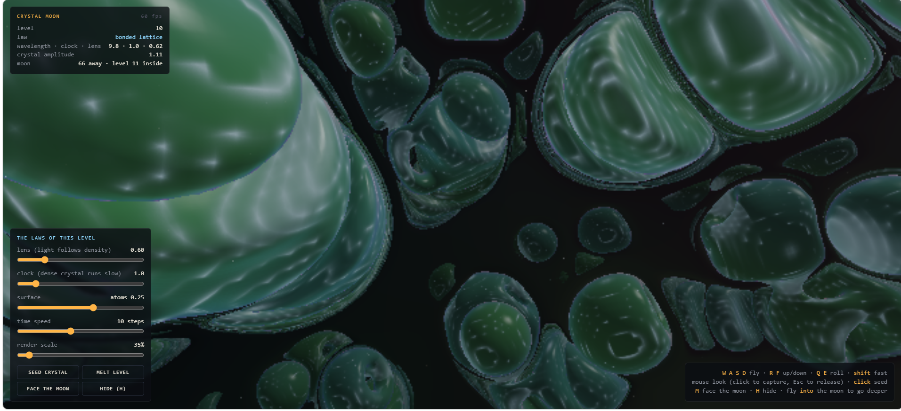

# Crystal Moon



A Mexican-hat field condenses into crystal. Where the crystal is dense, its clock runs slow and light bends toward it. The moon is a sphere inversion: inside it, the infinite world beyond is turned inside out, and its horizon becomes the moon's glowing core. Fly in, and the world inside becomes the world outside, and a new world starts growing in the moon.

One HTML page, WebGL2, no libraries. **Live:** https://anttiluode.github.io/CrystalMoon/

**Your camera.** Press **ENTER WITH YOUR CAMERA**, or **V** at any time. Your picture becomes part of the law:
- **Brightness gates ε.** Where you are bright, crystal may live; where you are dark, it melts. The picture becomes a crystal mosaic standing in the world.
- **Motion drives.** Where you move, new crystal is born, ice-white because it's newborn.
- **The picture is a pane of glass.** It is added to the light's density, so it bends what is behind it (the moon included) and glows faintly.
- **Your face is inside the moon too.** It is painted on a shell around the moon in the inner world, so through the inversion it appears on the near inside of the moon, the same way up.

**Controls:**
- **W A S D:** fly
- **R / F:** up and down
- **Q / E:** roll
- **Shift:** fast
- **Mouse:** look (click to capture)
- **Click:** seed a crystal
- **M:** face the moon
- **V:** camera on/off
- **H:** hide the panels

Fly *into* the moon to go a level deeper.

## The mathematics, and where each piece came from

**The crystals: Swift–Hohenberg, the Mexican hat lifted to 3-D.**

```
∂ψ/∂t = M(ψ) · [ ε(x) ψ − (q₀² + ∇²)² ψ + g ψ² − ψ³ ]
```

The operator −(q₀² + ∇²)² is a Mexican hat in Fourier space. It amplifies only waves of wavelength 2π/q₀ and damps everything else, so the field condenses into "atoms" one wavelength apart. With g > 0 in 3-D the lattice is body-centred cubic, the phase-field-crystal family of Elder & Grant (2002).

- **The surface slider** cuts the field at different levels: high shows atoms, lower shows atoms joined by necks, and negative shows the foam of bonds between them.
- **It settles rather than flickers.** It is a gradient flow, so it orders over time.
- **ε(x) sets where crystal can live.** It is positive on islands that crowd around the moon and negative in the open sea. Your flight adds a wake to it, so crystal grows where you have been and melts after the wake fades (~150 s).

**The clock.** M(ψ) = 1 / (1 + Tψ²): dense crystal evolves slower. This is the c² = 1/(1+Tφ²) tension term from `crystal_kingdom.py` (May 2025), the Clockfield idea.

**The lens.** The refractive index is n = 1 + κρ, where ρ is ψ² blurred over a wavelength. Rays follow the ray equation d(n d̂)/ds = ∇n, so light curves toward dense crystal the way it curves around mass. Stars and the moon visibly warp behind crystal clouds.

The clock and the lens are two uses of one idea. They are not derived from one action.

**The moon: antipodal sphere inversion.**

```
Φ(x) = c − R² (x − c) / |x − c|²
```

- **It turns the world inside out.** Φ swaps the inside of the moon with the entire outside and sends infinity to the centre.
- **It is the only kind of map that could.** By Liouville's theorem, the only maps of 3-D space that preserve angles are Möbius maps, built from inversions. A lens that turns outer into inner while keeping crystals locally crystal-shaped has to be one.
- **It is its own inverse and keeps orientation.**
- **On the moon's surface its derivative is a half-turn about the radius.** So you come out the other side turned over. That is not a bug: no orientation-preserving map can turn a ball inside out and leave your frame alone.
- **Inside the moon, the next level's world is drawn through Φ.** Its far distance glows at the centre.
- **Flying through swaps the worlds.** Your position goes through Φ, your frame through the half-turn, the inner world becomes the outer, and a new world (level + 1) starts crystallising inside the moon from a faint memory of the one you left.
- **Each level has its own law,** fixed by a hash of the level number: wavelength, g, clock, lens, which surface you see, and colour.

**How the camera enters the equation.** There are exactly two places input can go in this equation, and the camera uses both:

```
ε  ←  mix(ε, ε_sea + (ε_island + 0.1 − ε_sea)·b, w·gain) + 0.45·w·motion·d      (brightness b gates)
∂ψ/∂t ∋  0.04·w·motion·d                                                        (change d drives)
ρ_light ∋ 0.25·lens·w·b                                                         (the glass)
```

w(x) says where the picture sits. In the outer world it is a sheet about one atom thick at z = 11, 56 × 42 voxels, mirrored for a viewer looking toward the moon. In the inner world it is a shell around the moon on its far hemisphere, which the antipodal portal brings to the near inside.

b is the frame's luminance, contrast-normalised so exposure drift doesn't matter. d is change against a slow memory of the picture, with a short peak-hold. Driver versus modulator is the same split as basal input versus the apical tuft: d drives, b gates.

## Ledger

`node tests/core.test.cjs` checks the CPU reference in `core.js` (12/12):

| test | result |
|---|---|
| T1 one law per level, same every visit; explicit step inside the stability bound | worst dt·\|op\| = 1.50 < 2 |
| T2 strongest law: bounded, no NaN | max \|ψ\| 1.83 |
| T3 islands crystallise; the far sea stays empty | 68% of island voxels crystal; far sea max 0.012 |
| T4 the Mexican hat picks the wavelength | spectrum peaks at \|m\| = n/λ = 4 exactly |
| T5 the clock slows dense crystal | 1550 → 1750 steps to reach \|ψ\| 0.8 at T = 0 → 6 |
| T6 your wake writes crystal into empty sea; it melts when the wake is gone | max 1.38 → 0.002 |
| T7 portal: involution, \|Φx−c\|·\|x−c\| = R², conformal, sphere → antipode, half-turn derivative | all errors < 1e-13 |
| T8 Kelvin transform through the moon keeps harmonic fields harmonic | ∇² 1e-6 vs 0.87 for the naive pull-back |
| T9 camera brightness gates ε: the bright half of a picture crystallises, the dark half stays empty | 66% vs 0% of voxels after 2000 steps |
| T10 swap the picture: old crystal melts, new grows | 0% vs 75% after 2500 more steps |
| T11 motion is a driver: a moving patch in a black picture nucleates crystal only there | 70% in the patch, 0% elsewhere |
| T12 the face-in-the-moon shell comes through the portal on the near inside, the same way up and mirrored like the sheet | 2415 voxels checked, 0 wrong |

**The GPU matches the CPU.** Open `index.html?selftest` and the page steps the field on the GPU and in `core.js` from the same start. Over 25 steps the largest difference is 1.5e-8 without the camera, 3.0e-8 with a synthetic camera picture on the sheet, and 1.5e-8 on the moon shell (headless SwiftShader).

Found while calibrating: with the open sea at ε = −0.06, the crystal front creeps out and fills ~75% of the sea within 6000 steps. At −0.3 it stays on its island. So the sea is set to −0.3·max(1, g).

## What this is not (yet)

- **Real-GPU speed is known for one machine only.** Antti's screenshot (top of this page) shows 60 fps at render scale 35%, ten levels down. The camera adds two small texture reads per voxel; its cost on a real GPU is not yet measured.
- **The universe repeats every 64 units.** The field is periodic, so you are in one cell of an infinite crystal; fog hides most of the repetition.
- **Crystals grown from noise are polycrystalline:** grains and defects, not perfect lattices. The shapes are the BCC family, not carbon.
- **The descent is one way.** Only two worlds live in memory, so the way back up is gone once you go down.
- **There is no lensing inside the moon,** only the inversion.
- **The camera picture is coarse as crystal.** At wavelength 6 (the camera sets this, and the fineness slider changes it) the sheet holds about 9 × 7 atoms, so it is a mosaic, not a portrait. The glass and glow carry the picture at the 56 × 42 voxel grid. Turning on the camera also changes the level's wavelength, so the whole world gets finer.
- **The face in the moon uses the inner level's own wavelength** (7–11.5), so there it reads as a coarse shape.
- **Not tried on a real webcam yet.** Headless runs used Chrome's fake camera (a test pattern). Whether a real face is recognisable in crystal is untested.
- **The Kelvin result (T8) is about harmonic fields.** The crystal field is not harmonic: each level is its own simulation, viewed through the inversion, not derived from the level above.

## Files

- `index.html`: the world (simulation on the GPU, density lens, curved-ray raymarcher, moon portal, flight, camera)
- `core.js`: the laws, the CPU reference field, the portal maths and the camera placement; it is the spec the shaders mirror
- `tests/core.test.cjs`: the ledger

Built with Claude (Opus 5.5), Friday 9 October 2026, from a dream about `crystal_kingdom.py`, AnttisBrain2 and the moon as the lens between outer and inner.
